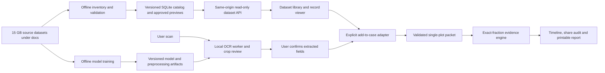

# Sutro: Professional Redesign & 15 GB Dataset Integration Plan

**Prepared:** 15 October 2026

**Implementation audience:** Claude / implementing developer

**Status:** Planning document; application implementation has not started under this plan.

**Product:** বাংলাদেশের একটি জমির জন্য document intake, ownership timeline, share audit এবং evidence report।

## 1. উদ্দেশ্য ও অনুমোদিত কাজ

Sutro-কে একটি modern, professional, সহজে ব্যবহারযোগ্য land-document workspace হিসেবে redesign করতে হবে। Existing exact-fraction evidence engine থাকবে; frontend-এর layout, navigation, forms, visual hierarchy, accessibility এবং animation উন্নত হবে। Dataset থাকলে সংশ্লিষ্ট records, previews, case examples ও model-assisted extraction dynamic হবে। Marketing এবং explanatory pages মূলত static থাকবে।

Owner জানিয়েছেন সম্পূর্ণ dataset প্রায় **15 GB**, এবং সেটি project-এর **`docs/` directory-এর ভেতরেই থাকবে**। এখনকার dataset folders integration বোঝার sample। নতুন corpus না দেখা পর্যন্ত তার file count, format, label completeness বা quality ধরে নেওয়া যাবে না। Size একা training quality বা application capability নির্ধারণ করে না।

এই document-এর সব phase implementation roadmap-এর অংশ। প্রথম milestone-এ modern UI + actual dataset browsing + reliable case workflow; পরের milestone-এ measured model training এবং assisted OCR। শুধু frontend সাজিয়ে বা শুধু demo data দেখিয়ে পুরো roadmap complete বলা যাবে না।

### Product boundaries

- একটি verification case একটি নির্দিষ্ট plot/dag এবং proposed sale নিয়ে কাজ করবে।
- Findings হবে contradiction, missing evidence, অথবা human review; ownership authenticity বা legal clearance ঘোষণা করা হবে না।
- Dataset records এবং user-supplied evidence-এর provenance দৃশ্যমান থাকবে।
- Automatically extracted তথ্য user review ছাড়া evidence engine-এ authoritative input হবে না।
- Existing Bangla/English support এবং exact `BigInt` rational arithmetic বজায় রাখতে হবে।
- Land inheritance rules redesign-এর অজুহাতে expand করা যাবে না; reviewed scope-এর বাইরে refusal বজায় থাকবে।
- No invented testimonials, institution endorsement, verified-owner badge, government connection, fake statistics বা unmeasured accuracy।

## 2. Current checkout থেকে পাওয়া baseline

নিচের findings source inspection-এর ভিত্তিতে; এই planning কাজের সময় app, training বা test suite চালানো হয়নি।

**GitHub delivery note (15 October 2026):** This baseline describes the original local ZIP checkout. During the later authorized delivery, GitHub `main` at `8176987403154978b6465eb4ed951187ee65861a` was found to contain newer UI/workspace code, scan IndexedDB, an ONNX adapter and recorded trained digit/line-reader artifacts. The local source files matched older commits, so delivery preserves the newer upstream application rather than replacing it with this older snapshot. Claude must reconcile each task against the current source in P00, reuse already implemented capabilities, and retain this document's quality/security/full-data acceptance requirements. Existing model records are not a substitute for rechecking runtime behavior.

**Dataset delivery instruction (latest owner decision):** Keep the supplied sample datasets and the future full approximately 15 GB corpus local; do not upload them to GitHub. This delivery includes the plan, dataset cards and setup documentation only. Raw sample folders, full-data roots, local ZIP archives and local archive manifests/checksums are ignored. No dataset ZIPs or Git LFS dataset pointers are delivered on `main`. Keep private data outside public website builds and configure actual sources during P00 and the dataset integration phases. See `docs/datasets/README.md` for the full corpus location.

| Existing area | Current evidence | Implementation implication |
|---|---|---|
| Frontend | Root HTML pages, `css/styles.css`, `css/site.css`, vanilla JS | Framework migration দরকার নেই; reusable modules ও build boundary যোগ করলেই হবে |
| Case state | `js/app.js` পুরো packet list `localStorage`-এ রাখে | Async per-case storage, migration এবং visible save errors দরকার |
| Import | `handleImport()` মূলত `docs` array দেখে; imports-কে synthetic করে | Versioned schema validation ও trustworthy provenance model দরকার |
| Scan attachment | `URL.createObjectURL()` দিয়ে preview | Refresh/page navigation persistence ও OCR processing নেই |
| Evidence engine | `js/engine.js`, `js/fraction.js`, `js/inheritance.js` | Core domain code UI থেকে পৃথক রেখে regression coverage দরকার |
| Digit experiment | `ocr.html` expects TensorFlow.js `model/tfjs/model.json` | Existing UI এক isolated digit পড়ে; full-page OCR নয় |
| Training | `kaggle/` TFJS digit notebook; dataset bundle-এর notebooks PyTorch/ONNX | Runtime/export format-এর explicit compatibility adapter দরকার |
| Local server | `scripts/serve.js` project root থেকে `fs.readFile()` করে | Private `docs` dataset এই server দিয়ে প্রকাশ করা যাবে না; stream + explicit public root দরকার |
| Publishing | `scripts/publish-github.ps1` uses `git add -A` | Dataset/model/private files accidental staging বন্ধ করা জরুরি |
| Repository state | Inspected checkout-এ `.git` নেই | Git baseline বা commit history অনুমান করা যাবে না; initialization/publishing আলাদা owner action |
| Tests/docs | Existing tests আছে; docs পুরোনো counts ও capability claims রাখে | Actual discovered tests চালিয়ে baseline লিখতে হবে; documented counts-কে pass evidence ধরা যাবে না |

**Sample packaging facts:** `docs/outputs/dataset_report.json` পুরোনো packaging report-এ দুই extracted bundle মিলিয়ে প্রায় 3.70 GB দেখায়। এটি owner-এর full 15 GB corpus-এর inventory নয় এবং live integrity verification-ও নয়। `outputs`-এ report/checksums থাকা মানে সংশ্লিষ্ট ZIP বর্তমান checkout-এ আছে—এমন নয়।

### Files to inspect first during implementation

- `README.md`, `package.json`, `.gitignore`.
- `index.html`, `intake.html`, `timeline.html`, `audit.html`, `report.html`, `about.html`, `ocr.html`.
- `js/app.js`, `js/partials.js`, both i18n files, `js/hero3d.js`.
- `js/engine.js`, `js/fraction.js`, `js/inheritance.js`, `js/demo-packets.js`.
- Both CSS files, `scripts/serve.js`, `scripts/kaggle.js`, `scripts/publish-github.ps1`, existing tests.
- `docs/DOCUMENTATION.md`, `docs/concept-note.md`, `docs/demo-script.md`.
- Dataset cards, manifests, notebook sources and a bounded sample of each actual data format.

## 3. Architecture সিদ্ধান্ত

### 3.1 প্রধান implementation shape

**Static-first multi-page frontend + a small same-origin dataset gateway + offline ingestion/training tools.**

- HTML pages, CSS design tokens এবং modular vanilla JavaScript রাখুন। React/Next/Laravel migration এই roadmap-এর prerequisite নয়।
- একটি ছোট deterministic build script শুধু explicit public files `dist/`-এ লিখবে। Dependency প্রয়োজন হলে supported release বেছে exact versions/lockfile ব্যবহার করুন; এই plan কোনো package version prescribe করছে না।
- Node gateway একই origin থেকে `dist/` ও `/api/v1/` serve করবে। এটি project root static serve করবে না।
- Offline Python tools CSV/JSONL stream করে SQLite catalog ও small preview derivatives তৈরি করবে। Images SQLite BLOB হিসেবে রাখা হবে না।
- Node read-only catalog থেকে indexed queries করবে; runtime-এ 15 GB recursively scan করবে না। SQLite access adapter একটি supported, maintained driver ব্যবহার করবে; query work main HTTP event loop block করতে পারবে না।
- Original datasets `docs/`-এ অপরিবর্তিত থাকবে। Generated catalog, private uploads, logs ও training runs পৃথক ignored private directories-এ থাকবে।
- Case drafts browser IndexedDB-এ থাকবে। Full dataset, model training arrays বা সব cases browser storage-এ copy হবে না।
- OCR-এর canonical new runtime হবে exported ONNX model + matching preprocessing/charset in a browser worker, প্রথমে CPU/WASM compatibility যাচাই করে। Optional accelerated backend capability check করে enable হবে। Existing TFJS experiment transition-এর সময় আলাদা adapter দিয়ে চলবে; এক model format অন্য loader-এ পাঠানো যাবে না।
- Training offline/local GPU অথবা owner-configured compute environment-এ হবে। Website request থেকে training start হবে না।

### 3.2 Delivery profiles

| Profile | Dataset behavior | Privacy/security boundary | Required delivery |
|---|---|---|---|
| `static-demo` | Explicitly curated, publish-approved small records/manifest | No full corpus, private scans বা training files in `dist/` | Required: public presentation and offline demo |
| `local-full` | Gateway indexes configured full corpus physically under `docs/` | Loopback bind, Host/Origin checks, local launch session, restricted records denied by default | Required: actual 15 GB integration target |
| `hosted-full` | Same gateway on hosted disk/volume; pagination unchanged | Authenticated dataset access, HTTPS, per-record authorization, server storage/retention controls | Deployment extension; gated before exposing private/full APIs remotely |

`local-full` complete মানে public multi-user service complete নয়। `hosted-full` নির্বাচন করলে P13-এর hosted security tasks deployment-এর বাধ্যতামূলক dependency হবে। Shared case editing, cloud case sync, billing এবং government APIs এই redesign-এর deliverable নয়।

### 3.3 Data flow



Dataset annotations/expected findings are a reference lane. Predictions and submitted evidence are separate lanes. Ground-truth labels must never masquerade as live OCR output or be supplied secretly to the engine.

### 3.4 Proposed directory boundary

```text
index.html, intake.html, timeline.html, audit.html, report.html, about.html, ocr.html
workspace.html, library.html                   # new static page shells
css/                                          # tokens, components, page styles, print
js/
  core/                                       # state, validation, storage, API client
  components/                                 # navigation, dialog, feedback, viewer
  pages/                                      # page controllers
  data/                                       # dataset adapters and case conversion
  workers/                                    # analysis/OCR workers when needed
  engine.js, fraction.js, inheritance.js       # preserve domain behavior
assets/                                       # fonts, icons, static visual assets
public-data/                                  # only approved small demo records
server/                                       # gateway, catalog repository, access policy
tools/data/                                   # inventory, validation, indexing, thumbnails
training/                                     # maintained training entrypoints/configs
config/                                       # schemas and non-secret example config
model/                                        # explicitly approved inference artifacts
docs/
  PROFESSIONAL_REDESIGN_IMPLEMENTATION_PLAN.md
  dataset_1_land_ocr/                          # existing sample source, do not move blindly
  dataset_2_numta_digits/                      # existing sample source, do not move blindly
  datasets/full/                              # canonical location for incoming full corpus
  .runtime/                                   # ignored catalog revisions and local reports
  implementation/                             # tracked concise phase reports, no PII
storage/private/                              # ignored imports/temp job data if needed
dist/                                         # explicit public build; no docs bulk-copy
tests/                                        # domain, integration, browser/security suites
```

Existing folder names need not match the proposed full-corpus layout. A **dataset source registry** maps logical dataset IDs to configured roots under `docs/`; adapters handle supported formats. Do not rename, duplicate or relocate 15 GB just to match a preferred tree. Implement source discovery only over explicitly registered roots, never arbitrary disks.

## 4. Dataset-to-feature mapping

| Dataset component | Product use | Adapter/training work | Important constraint |
|---|---|---|---|
| `khatian_form5462/pages` + `annotations.jsonl` | Preview records, inspect fields, supported-template OCR experiments | Page/field catalog; coordinate-aware viewer; layout validation | Synthetic printed pages, one layout; survey labels do not prove real CS/SA layout support |
| `ocr_cells/labels.csv` + crops | Bangla text-line recognition | CRNN training and crop inference | OCR crop accuracy is different from full-page extraction accuracy |
| `ocr_cells_packed/` | Faster offline training input | Use packed files with bounded-memory loaders/shards | Raw crops and packed representation are the same examples, not extra independent data |
| `lands`, `khatians`, `owners`, `dag_rows`, `title_line` CSVs | Search, versions, owner/share tables, dataset relationship viewer | Explicit joins and exact-number conversion | Multi-dag/partial interests cannot be blindly flattened into one complete plot |
| `synthetic/packets` | Selectable example cases and engine regression inputs | Import individual validated packets; strip test-label metadata from user API | Same-author expected labels are self-consistency evidence only |
| `synthetic/number_strings` | Multi-digit/string recognition experiments | String model or supported segmentation evaluation | A single-digit classifier cannot read arbitrary number strings |
| Dataset 1 processed Numta + Dataset 2 originals | Isolated digit model | Preserve derivative lineage and one coordinated split | Original/processed duplicates must not cross independent evaluation sets |
| `real_public/dolil_deeds` | Private research/annotation review if permitted | Restricted catalog, manual labels before supervised training | Unlabelled real deeds; publication restrictions in dataset card |
| New full-corpus formats | Extend only identified capabilities | Inventory, schema adapter, license/privacy classification | Unknown types remain unsupported/quarantined; no silent coercion |

**Do not join unrelated dataset universes.** The khatian page generator and synthetic reasoning packet generator are separate sources. Similar names, numbers or dates are not a cross-dataset foreign key. An explicit mapping is required before connecting entities.

## 5. Product and visual design specification

### 5.1 Visual direction

একটি calm, precise **land evidence workspace**। Light default, warm white surfaces, deep green actions, readable Bengali typography, clear document hierarchy। Existing land/document identity থাকবে; generic crypto dashboard, excessive glass effects বা crowded government-form appearance এড়াতে হবে।

| Token group | Initial direction | Acceptance condition |
|---|---|---|
| Background/surface | `#F6F8F5`, white cards | All pages share one theme; light on first render |
| Primary/ink | Green `#0F5747`, ink `#122A23` | Contrast measured before finalizing combinations |
| Border/decorative accent | `#DCE5DD`, muted gold `#B18135` | Gold decorative; status readable without color alone |
| Typography | Self-host Noto Sans Bengali for UI; restrained Noto Serif Bengali for report headings; system Latin fallback | Proper conjuncts, line height, no missing glyphs; font licenses retained |
| Spacing | 4/8 px base rhythm; generous groups | Consistent across landing, workspace, forms and report |
| Shape/elevation | 10–16 px restrained radii; low shadows | Nested cards are distinguishable without heavy effects |
| Layout | Max public content around 1200 px; workspace can expand around 1440 px | Good reading width; no desktop-wide paragraph walls |
| Controls | Comfortable touch targets, clear focus/disabled states | Keyboard and touch users can complete the flow |

Bangla is the proposed first-visit language, English toggle remains; preserve an existing saved language choice. Language choice, theme and content must not flash into a different initial state. Numeral normalization is input handling, not a change to stored document identifiers or calendar meaning.

### 5.2 Information architecture

Primary public navigation: **Home → How it works → Start a case → Sample records → About**. Workspace navigation: **My cases → Intake → Timeline → Share audit → Report**. Dataset library is an input aid; developer dataset tools, training controls and machine paths stay out of citizen workflows.

| Page/area | Required redesign and behavior |
|---|---|
| Home | Clear purpose, one primary Start case CTA, secondary Explore example; concise 3-step explanation, document-led visual, real capabilities, meaningful data/privacy explanation |
| My cases | Searchable case cards/list, last saved timestamp, draft/review state, resume, duplicate, export and deliberate delete; demo cases visually separated |
| Intake | Guided sections: plot/offer → documents → field review → ready to analyze; editable source preview next to selected document; progress means completed inputs, not legal certainty |
| Dataset library | Search/filter with paginated records; actual loaded dataset/version label; synthetic/real restriction labels; empty/unavailable/retry states |
| Record viewer | Preview zoom/rotate, field-to-image highlight where annotations exist, metadata, source/license, survey/version relationships, explicit Add to case |
| Timeline | Readable event chronology, document links, chain vs record explanation, coverage gaps, same-year ambiguity note when relevant |
| Share audit | Seller's proposed area versus evidence-supported accounts; exact fraction details; table/accessible bars; assumptions and unresolved estates visible |
| Report | Plain-language overview, findings grouped by meaning, next-document checklist with office/source, references, export/print, version/as-of metadata |
| OCR assistant | Document/crop selection, processing stage, editable candidates, source highlights, low-confidence/unsupported states; model unavailable has a usable manual path |
| About/methodology | Accurate capabilities, provenance, dataset/model versioned metrics when measured, limitations and attribution; omit unfinished team placeholders |

### 5.3 Animation specification

- Buttons/tabs/focus feedback: roughly 120–180 ms; panel/dialog changes: 180–240 ms; section entry: 240–400 ms.
- Animate primarily opacity and transform; keep movement small, usually no more than 8–12 px.
- Landing visual may use an SVG plot grid/document stack with a short reveal. Existing Three.js scene may remain only as a lazy optional enhancement with static fallback.
- No continuously moving background behind forms, no parallax required to read content, no forced scroll or artificial processing delays.
- `prefers-reduced-motion` removes nonessential animation and skeleton shimmer; all actions remain usable.
- Pause/dispose offscreen WebGL/animation resources, observers, timers and stale model tensors. No page navigation leaks.
- Animated share bars must retain accessible numeric labels and exact engine values. Decorative animation never changes report conclusions.
- Loading, success, retry and cancellation use real operation state; do not fake progress percentages.

### 5.4 User experience contracts

- Primary tasks need plain labels, short field help, realistic synthetic examples and inline validation.
- Autosave must say Saving/Saved/Failed; a failed save cannot look successful.
- No-data, no-results, source unavailable, restricted record, corrupt import and model unavailable are distinct states.
- Delete/reset/import replacement needs a specific consequence explanation; avoid routine confirmation dialogs for harmless edits.
- A stale response must not overwrite a newer search, a different case or manual OCR correction.
- Mobile source preview/editor becomes a switchable or stacked layout; do not shrink desktop tables into unreadable content.
- At 320/360/390/768/1280/1440 px and 200% zoom, navigation, forms and report remain operable.
- Case progress, user-reviewed extraction and document copy type must not be presented as certified legal authenticity.

## 6. Phase roadmap and dependency order

| Phase | Outcome | Dependencies |
|---|---|---|
| P00 | Verified baseline, full-data readiness checklist and implementation decisions | None |
| P01 | Dataset isolation, safe serving/publication and input security foundation | P00 |
| P02 | Modular architecture, versioned contracts and draft migration | P01 |
| P03 | Reusable visual system, accessible components and motion primitives | P02 |
| P04 | Modern public pages and navigation | P03 |
| P05 | Guided case workspace and reliable document intake | P03; compatible with P04 navigation |
| P06 | Streaming full-dataset validation and indexed catalog | P01, P02 |
| P07 | Safe, paginated same-origin dataset API | P06 |
| P08 | Dynamic dataset library, previews and real record states | P03, P07 |
| P09 | Correct dataset-to-case mapping and redesigned analysis/report | P05, P08 |
| P10 | Reproducible training, evaluation and runtime model packages | P06; independent of visual completion |
| P11 | Reviewed OCR assistance integrated with intake | P05, P09, P10 |
| P12 | Integrated accessibility, security, performance and full-corpus acceptance | P04–P11 |
| P13 | Documentation, packaging, rollback and deployment handoff | P12 |

Default execution order is numerical. P06 may begin after P02 while UI work proceeds, and P10 may start after P06. Completing one branch never substitutes for the other branch's exit gates.

**Task status:** `[ ] pending`, `[~] in progress`, `[x] complete with evidence`, `[!] blocked with reason`. All tasks below start pending. Record actual completion in a companion progress file, retaining this plan as the agreed scope.

## P00 — Baseline and implementation contract

**Goal:** Implementer বুঝবে existing product, data formats এবং কোন ফল যাচাই করতে হবে।

- [ ] **P00-T01 — Source and workspace inventory.** Read the files in section 2; identify AGENTS instructions, dirty files if Git exists, active server listeners and existing assets. Record the current branch or explicitly state no `.git`. Do not initialize Git, publish, stop shared services or move datasets as a planning convenience.
- [ ] **P00-T02 — Runtime baseline.** Start only the required local app port after checking ownership; inspect all pages and three demo packets. Capture desktop/mobile screenshots and current numerical results. Discover actual tests; run the engine/inheritance suites with explicit filenames if directory discovery fails on the chosen Windows Node runtime. Record actual command/version/results, not README counts.
- [ ] **P00-T03 — Dataset readiness.** Inventory the available sample roots by type/size/schema using bounded output. Compare to reported packaging facts. Record the incoming 15 GB root(s), expected formats and unknowns; do not claim full-data acceptance until full files are present.
- [ ] **P00-T04 — Product decisions.** Record the default local-full and static-demo profiles, language/light theme, page map, single-plot scope, retention policy and target machine/browser. Document hosted-full as a separate deployment gate.
- [ ] **P00-T05 — Acceptance fixtures.** Select public-safe synthetic packets/pages for visual and integration checks. Keep synthetic reasoning labels and OCR ground truth isolated from app inference inputs. Define a deterministic engine snapshot comparator using exact fraction strings.

**Deliverables:** `docs/implementation/BASELINE.md`, `ARCHITECTURE_DECISIONS.md`, sanitized baseline screenshots, dataset readiness summary.

**Exit gate:** Existing behavior and available data are documented; unverified model/full-data capabilities are explicit. A new reader can reproduce the baseline.

## P01 — Security and dataset storage boundary

**Goal:** 15 GB `docs`-এ থাকলেও application বা publishing path দিয়ে অনিচ্ছাকৃত exposure হবে না।

- [ ] **P01-T01 — Public build allowlist.** Create an explicit `dist/` packaging script for intended HTML/CSS/JS/fonts/icons, approved public-data fixtures and selected model files. Prohibit recursive project-root or `docs/` copy. Inspect build artifacts automatically for excluded path categories and secret/private patterns. Expose reviewed documentation only through an explicit safe subset when needed.
- [ ] **P01-T02 — Static server replacement.** Serve only the public build root. Decode malformed URLs safely; handle HEAD/method restrictions, not-found and errors. Canonicalize filesystem paths and account for Windows separators, drive/UNC paths, alternate streams, symlinks and junctions. Stream allowed files with backpressure; never `readFile()` a dataset archive into memory for a request.
- [ ] **P01-T03 — Git/publication exclusions.** Ignore actual dataset roots, `docs/datasets/full/`, `docs/.runtime/`, private storage, unapproved checkpoints and local source configuration. Replace blanket staging in `publish-github.ps1` with inspectable, explicit release behavior and a large/private-file preflight. `.gitignore` does not remove already tracked/history data; if discovered, report the exposure and handle it as a separate scoped remediation.
- [ ] **P01-T04 — Input/rendering audit.** Trace all dataset/import-derived strings through `docLabel()`, `refreshTitles()`, finding chips, table cells, hash selectors and URL attributes. Use DOM text APIs for dynamic text; do not rely on a mixture of partially escaped string templates. Validate IDs before selectors, use safe references, and reject poison object keys such as `__proto__`, `constructor` and `prototype` at import boundaries.
- [ ] **P01-T05 — Request and execution controls.** No web-triggered dataset indexing, shell command, Python training or arbitrary URL fetch. Dataset roots/model paths come from trusted startup config. Local-full binds loopback and rejects unexpected Host/Origin; protect private API calls with an ephemeral launch session, same-origin policy and appropriate cookie/CSRF controls for any mutations. Avoid wildcard CORS or sensitive tokens in URLs/localStorage/logs.
- [ ] **P01-T06 — Browser policy.** Move inline executable scripts and event handlers into files. Self-host pinned runtime assets/fonts where practical, define a measured CSP and security headers, and test real OCR/worker execution under the policy. Any WASM-specific CSP exception must be narrowly scoped and documented; do not add broad `unsafe-eval`/`unsafe-inline` to silence errors. HTTPS-only headers apply in hosted production, not as a claim about local HTTP.

**Deliverables:** Public build/serve boundary, publication preflight, first schema limits, written threat model and negative security checks.

**Exit gate:** Requests for `docs` corpora, runtime catalogs, configuration, private scans and non-public server/training sources fail. Intended frontend JS remains explicitly served. Crafted labels do not execute code. Intended fonts/animations/model loading work under the actual policy.

## P02 — Modules, contracts and case storage

**Goal:** Existing app logic modular করে predictable data flow ও safe migration তৈরি করা।

- [ ] **P02-T01 — Module boundaries.** Extract shared UI, form state, case repository, dataset client, validation and rendering from `js/app.js`. Retain the engine's existing Node/browser compatibility until both paths have equivalent results. Avoid copying engine rules into page controllers.
- [ ] **P02-T02 — Versioned packet schema.** Define an envelope with schema version, packet data, application-managed provenance, review metadata and case revision. Support old packet imports through an explicit migration. Enforce discriminated document types, required/optional fields, unique document IDs, bounded arrays/depth/string lengths, safe integers for years and bounded rational strings. Reject or quarantine unsupported versions.
- [ ] **P02-T03 — Exact input normalization.** Normalize Bangla digits and permitted separators at a typed boundary, preserving raw document text. Strictly validate years rather than permissive `parseInt()` prefixes. Preserve identifiers as strings, including leading zeros. Keep area/share values as exact decimal/rational strings; do not introduce binary floats into ledger calculations.
- [ ] **P02-T04 — IndexedDB case repository.** Store cases individually with transactional revisions; keep lightweight language/theme preferences in localStorage. Add quota/error handling, debounced per-case saves, conflict detection between tabs, explicit export and clear-local-data. Cases remain device-local; browser eviction and lack of cloud backup must be accurately communicated. IndexedDB is not encryption or a defense against XSS.
- [ ] **P02-T05 — Legacy migration and attachments.** Migrate `sutro.packets.v1` only after validation into a versioned store. Preserve the original until migration verification succeeds. Never silently discard corrupt packets or quota failures. Persist scan blobs only with an explicit user storage choice; keep session-only as the private default, visibly identify it, and release object URLs on replacement/deletion/navigation.
- [ ] **P02-T06 — Typed operational states.** Define loading/empty/ready/restricted/error/cancelled states, abortable fetches and case-revision-aware processing. An expired dataset cursor, stale OCR result or save race must not overwrite current state. Persist checklist progress by stable case/finding keys.
- [ ] **P02-T07 — Data provider interface.** Give page controllers one interface for capabilities, filtered lists, record details, previews and selected packets. The static-demo provider reads only a small approved generated manifest/record set in `public-data/`; local-full uses the paginated API. They share schemas and state handling, not a fake full-dataset response. Static-demo works when no gateway/full corpus is available and never falls through to private files.

**Deliverables:** Module map, packet/API schemas, case repository, tested legacy import/export/migration and documented limits.

**Exit gate:** Existing demo results match baseline unless an independently documented domain fix explains a change. Reload/navigation retains valid cases; migration failure preserves originals; malicious imports fail safely.

## P03 — Design system and motion foundation

**Goal:** Section 5-এর visual language সব page-এ reusable component হিসেবে establish করা।

- [ ] **P03-T01 — Design tokens.** Implement palette, type scale, spacing, borders, radii, layout widths and z-index tokens; light first paint; self-host licensed fonts. Check Bengali glyph rendering in browser with correct UTF-8 decoding before deciding a file is corrupt based on console output.
- [ ] **P03-T02 — Shared components.** Build navigation, breadcrumbs, stepper, case switcher, button, input/select, field error, card, badge, tabs, disclosure, dialog, toast/live region, pagination, skeleton, empty/error state and document viewer controls. Prefer semantic HTML; no duplicate component implementations per page.
- [ ] **P03-T03 — Motion primitives.** Implement durations/easing and reduced-motion defaults from section 5.3 using CSS/standard browser animation APIs. Dispose observers/listeners. Add a static fallback to optional 3D and prevent animation from delaying input.
- [ ] **P03-T04 — Responsive/accessibility specimens.** Validate representative components at target widths and zoom; contrast, keyboard focus, dialog focus restoration, screen-reader labels and accessible touch targets. Use WCAG 2.2 AA as a review target, not a compliance claim without evidence.
- [ ] **P03-T05 — i18n presentation.** Consolidate translation ownership; ensure labels, errors, statuses, empty states and print text switch consistently. Respect stored language; prevent text clipping on longer Bangla translations. Format dates explicitly for the chosen locale/timezone; as-of year remains a user-controlled engine input.

**Deliverables:** Documented token sheet/component specimen page, responsive samples and reusable motion utilities.

**Exit gate:** One consistent visual system, no inaccessible custom control replacements and no first-render dark flash.

## P04 — Public pages and professional presentation

**Goal:** প্রথমবারের user দ্রুত বুঝবে Sutro কী করে এবং কোথা থেকে শুরু করবে।

- [ ] **P04-T01 — Home redesign.** Build the hierarchy in section 5.2: concise Bangla/English pitch, primary case CTA, secondary synthetic example, process explanation and land/document hero visual. Use semantic SVG/CSS and existing assets; optimize optional Three.js loading/fallback.
- [ ] **P04-T02 — Navigation and trust content.** Create consistent desktop/mobile navigation, active locations, keyboard menu behavior and footer. Show dataset/case provenance at meaningful points; repeated full-width warnings must not crowd the workflow.
- [ ] **P04-T03 — About/methodology redesign.** Present supported features, exact calculations, evidence limitations and separate OCR research metrics. Remove placeholder team entries until real details are supplied. Update obsolete claims that the entire repository has no real records, because the dataset bundle includes real deed scans.
- [ ] **P04-T04 — Real capability/status binding.** Home may show approved dataset summary counts only from a generated versioned manifest/API. With no dataset show a truthful available-feature state, not invented counters. Training epochs, fault labels and backend paths are not citizen-facing marketing.
- [ ] **P04-T05 — Metadata and page performance.** Add meaningful titles/descriptions, favicon, share-safe preview, language metadata and correct links. Prevent indexing of private/local routes where applicable; robots/noindex are presentation measures, not access control.

**Deliverables:** Redesigned public pages, responsive navigation, accurate bilingual content and optimized hero.

**Exit gate:** A new user can explain the purpose, start a case or open a labelled example without developer guidance; mobile and reduced-motion views work.

## P05 — Case workspace and guided document intake

**Goal:** Manual entry, corrections ও next-step workflow user friendly এবং dependable করা।

- [ ] **P05-T01 — My cases.** Implement `workspace.html` with resume/create/search, clear demo/user distinction, per-case last-saved state, duplicate/export/delete. Keep dataset sample browsing outside the personal draft list until explicitly imported.
- [ ] **P05-T02 — Guided intake.** Organize plot/offer, document type, document details and review. Maintain direct edit navigation; never require a wizard restart for a small correction. Show missing required fields and link directly to them.
- [ ] **P05-T03 — Source and field layout.** Desktop: source viewer plus selected document form; mobile: readable stacked/switchable panels. Add zoom/rotate and field focus highlighting; unsupported preview types have a manual path. Session-only attachments are identified honestly.
- [ ] **P05-T04 — Validation/recovery.** Localized actionable field errors, unsaved state, failed-save retry and intentional delete/reset behavior. Keep focus/caret while editing repeated owner/heir rows; avoid full-page rerender for each keystroke. Add accessible row controls and long-name/fraction layouts.
- [ ] **P05-T05 — Review checklist and provenance.** Mark fields manual/imported/OCR-candidate/user-reviewed in case metadata. Copy type is user-reported document provenance, not automatically authenticated. Completeness checks help data entry without silently turning unsupported cases into approved ones.
- [ ] **P05-T06 — Import/export usability.** Preview case/document counts before adding a valid packet; preserve case IDs internally without collisions. Import one packet JSON through the app; bulk CSV/JSONL ingestion belongs to the offline pipeline. Export versioned JSON, preserving exact fractions and permitted source references without absolute machine paths.

**Deliverables:** New workspace, guided intake, stable editable rows and persistent, reviewable cases.

**Exit gate:** A user can create/import a case, attach a source, fix errors, move between pages, resume and export without losing input. No case is marked reviewed solely because a model or dataset supplied it.

## P06 — Full dataset inventory, validation and catalog

**Goal:** Incoming 15 GB corpus-এর supported অংশ bounded memory-তে index করা এবং app-এর জন্য queryable করা।

- [ ] **P06-T01 — Dataset source registry.** Register existing sample roots and the owner's full roots under `docs/`. Include dataset ID/version, adapter, relative root, license, declared access class, intended tasks and expected schema. Resolve/validate roots at startup; do not scan every folder called `docs`. Keep machine-specific paths in ignored local config and never expose them through API responses.
- [ ] **P06-T02 — Streaming inventory.** Enumerate metadata once; stream CSV/JSONL parsing and SHA-256 calculation in batches. Record bytes, file type, dimensions where needed, source-relative path, stable asset ID and source/derivative lineage. Preserve upper/lower-case image extensions. Avoid loading all annotations, pixels, packets or compressed arrays into RAM at once.
- [ ] **P06-T03 — Format and relationship validation.** Validate required CSV columns, types, IDs, row counts, label references, missing files, field polygons, duplicate keys, image pixel limits, exact areas/shares and cross-table relationships. Classify errors: invalid critical joins block a catalog release; unsupported independent files may be quarantined with a visible reason. Unknown data must not be silently dropped to make totals match.
- [ ] **P06-T04 — Integrity and split preservation.** Identify exact duplicates and known raw/processed equivalents; keep all versions of a land in one split. Preserve original Numta train/test roles and audit overlap of corrected test folders. Block train/evaluation leakage based on recorded lineage; do not infer writers are separated when IDs are unavailable.
- [ ] **P06-T05 — SQLite catalog generation.** Build the schema in section 7 into a new temporary revision, in transactions with foreign keys and indexes. Store references and small validated structured rows, not source image BLOBs. Create deterministic public projections separate from private raw metadata. Validate then atomically activate the complete revision; a failed import leaves the last good catalog usable.
- [ ] **P06-T06 — Preview derivatives.** Generate bounded thumbnails lazily/offline, with size/dimension caps and safe metadata removal. Synthetic previews may be publish-approved; real deed previews are restricted by default, including thumbnails. Cache by source hash, transformation version and access class; no private thumbnail in shared/public caches.
- [ ] **P06-T07 — Operations and full-corpus run.** Provide read-only inventory/validate/index commands, resumable checkpointing, cancel/retry, disk-space preflight and sanitized reports. Original files are never regenerated or rewritten. In particular, the legacy `verify_packets.js` writes `_verify_report.json` into its input folder; adapt/wrap diagnostics so reports go to `docs/.runtime/`, rather than running mutating tools against source roots.

**Deliverables:** Registry/schema, ingestion adapters, catalog migrations/build tool, integrity/lineage manifest, resumable jobs and a sanitized full-corpus report when the 15 GB data is available.

**Exit gate:** Sample indexing passes first; then a complete actual 15 GB ingest/restart run passes on the target machine. Re-running unchanged sources is idempotent; interrupted indexing does not corrupt the active catalog; raw hashes remain unchanged.

**Missing full corpus:** P06 can be sample-verified while waiting, but full-data gate stays open. Do not generate filler files or repeat data to simulate 15 GB acceptance.

## 7. Catalog and API contracts used by P06–P09

### 7.1 Minimum catalog schema

Catalog is derived, rebuildable and read-only to the runtime gateway. User cases stay out of this source catalog.

| Table | Required information | Keys/indexes |
|---|---|---|
| `datasets` | Logical ID, version, task/domain, source lineage, source manifest hash, license/access policy, ingest state | Unique `(dataset_id, version)` |
| `assets` | Dataset version FK, source-relative path, SHA-256, bytes, validated media type, dimensions, split, access class, derivative parent, preview reference | Unique `(dataset_version_id, relative_path)`; indexes `(dataset_version_id, kind, split, id)`, `sha256`, `parent_asset_id` |
| `lands` | Source-qualified land ID, normalized searchable location fields, JL, source split | Unique `(dataset_version_id, source_land_id)`; location/JL indexes for supported filters |
| `khatians` | Land FK, source khatian ID, survey, year, khatian number, image FK, exact total-area string, sheet metadata | Unique source-qualified ID; `(land_id, survey, year, id)`; searchable khatian number index |
| `owners` | Khatian FK, source row ID, display name, normalized search text, exact share string, printed share text | `(khatian_id, source_row_id)` unique; `(khatian_id, id)`; separate approved text search |
| `dag_rows` | Khatian FK, row index, dag, land class, exact original numeric strings including area/share-in-dag | Unique `(khatian_id, row_index)`; `(khatian_id, dag_no, id)` |
| `title_edges` | Source-qualified from/to khatian FKs, transition type, generator/reference metadata | Index both FKs; validate same land and valid chronology |
| `packets` | Dataset version FK, source packet ID, split, validated bounded packet payload/projection, provenance | Unique source-qualified ID; indexes `(dataset_version_id, split, id)`; label metadata kept in evaluator-only storage |
| `field_annotations` | Asset FK, field type, row index, original text, polygon coordinates, annotation source | `(asset_id, field_type, row_index, id)`; keep source coordinates/version |
| `catalog_runs` | Input manifest hash, schema version, counts/errors, active revision, timestamps | Unique run ID; sanitized status projection |

Use foreign keys; no unbounded `SELECT *`. Select only list/detail fields needed for the request. Numeric source strings remain exact; presentation totals must not depend on SQLite REAL arithmetic. Cross-source IDs are namespaced.

For text search, implement escaped prefix/token search using an indexed strategy and verify query plans. If SQLite FTS5 is used, confirm Unicode/Bengali behavior with real labels; do not claim stemming/transliteration support without implementing it. Avoid unrestricted leading-wildcard scans. Every accepted sort option maps to fixed SQL, never interpolated client input.

### 7.2 Dataset source and public record contract

- Manifest fields: schema version, logical dataset/version, source kind, adapter version, counts by supported kind/split, license/attribution, source hash, access class and capabilities.
- Internal-only fields: absolute paths, private source notes, research labels, original personal data outside permitted projection, server config and errors with stack traces.
- Public dataset identifiers are stable opaque IDs. An opaque ID is not authorization; every lookup checks access policy.
- A preview and its metadata inherit the same restriction as their source.
- Access classes: `public-approved`, `local-review-only`, `restricted`; ingestion defaults new real/unknown sources to restricted. The local operator must record an explicit permission decision before serving restricted research material.
- Dataset version belongs in records, cursors, ETags, case source references and model lineage. Reload after a catalog revision returns a friendly version-change state instead of mixing versions.

### 7.3 Minimal endpoint contract

| Endpoint | Request/response | Controls |
|---|---|---|
| `GET /api/v1/capabilities` | Enabled profile, approved dataset versions, model availability, supported record kinds | Do not leak private source names/paths; no claim of full-data readiness from sample mode |
| `GET /api/v1/datasets` | Allowed datasets and bounded summary counts | Access-policy filtered counts and metadata |
| `GET /api/v1/records` | Allowlisted dataset/version/kind/survey/location/search filters, cursor, limit; returns small list projection | Default 24 items; maximum 100; indexed deterministic order |
| `GET /api/v1/records/:id` | Allowed record detail, version, exact-value strings, source references | Access check per ID; bounded detail rows with separate pagination when needed |
| `GET /api/v1/records/:id/relationships` | Paginated explicit same-source versions/links | No inferred cross-dataset identity links |
| `GET /api/v1/assets/:id/preview` | Safe thumbnail/image stream of an authorized asset | ID-to-file mapping, canonical root checks, validated type, correct private/public cache policy |
| `GET /api/v1/packets/:id` | One validated user-facing packet | Strip injected-fault labels, expected findings and internal file paths |
| `GET /api/v1/models` | Approved inference model metadata and matching artifact IDs | No arbitrary remote model URL or user filesystem path |
| `GET /health/live`, `GET /health/ready` | Minimal liveness/readiness status | Ready fails if required catalog/config is unavailable; models reported separately |

Use a consistent error envelope: safe code/message, optional field errors and request ID. Handle 400 validation, 401/403 policy, 404 safe missing record, 409/410 stale catalog/cursor, 413 bounds, 429 resource limits and 503 dependency unavailable appropriately. Avoid unnecessary existence disclosure for private records.

Cursor must bind dataset revision, filter/sort and last composite key; validate length/types and reject tampering. Limits apply before deserialization/query work. Abort disconnected requests; no whole-corpus list endpoint. There is no public web endpoint for imports, migrations or dataset reindexing.

## P07 — Same-origin dataset gateway

**Goal:** Dataset থেকে দ্রুত ও নিরাপদ read-only dynamic data দেওয়া।

- [ ] **P07-T01 — Repository/query layer.** Implement section 7 endpoints using parameterized SQLite queries, fixed selected columns and allowlisted filters. Use composite cursor pagination. Verify typical filters with `EXPLAIN QUERY PLAN`; add only justified indexes and record their storage cost.
- [ ] **P07-T02 — Policy enforcement.** Apply dataset/version/asset access policy uniformly to list, detail, relationships, counts and preview. Fail closed on missing policy. Do not expose evaluator labels to the public API or use a flag supplied by an imported packet as authorization.
- [ ] **P07-T03 — Secure media streaming.** Map asset IDs to catalog-registered paths only. Reject traversal, drive/UNC/alternate-stream escapes and symlink/junction escapes. Implement correct content type, nosniff, cancellation/backpressure and bounded concurrency. Optional Range support must validate byte ranges and not enable resource abuse.
- [ ] **P07-T04 — Lifecycle/caching.** Open catalog read-only; manage atomic catalog swaps without mixing revisions. Use ETag/version caching for approved immutable public assets; private responses use restrictive caching and no shared cache. No filesystem traversal at request time; small bounded metadata cache only after measurement.
- [ ] **P07-T05 — Resource and origin protections.** Configure body/query limits, request timeouts, rate/concurrency limits and local Host/Origin policy. Treat localhost as reachable from other browser origins, not automatically trusted. Redact private record content, local paths and tokens from logs; bound log growth.
- [ ] **P07-T06 — Real readiness.** Report public shell, catalog and optional model readiness separately. Missing dataset returns a usable application state and 503 where appropriate, not an empty successful result falsely presented as a completed data load.

**Deliverables:** API specification, gateway, query plan evidence, access-policy checks, streamed media and health behavior.

**Exit gate:** On the real catalog, only one bounded page/detail/preview is read per action. Restricted record IDs cannot bypass policy through any endpoint; malformed requests do not crash the server.

## P08 — Dynamic dataset library and record viewer

**Goal:** Full corpus থাকা অবস্থায় user প্রয়োজনের record খুঁজে case-এ আনতে পারবে।

- [ ] **P08-T01 — Library UI.** Implement `library.html` with dataset/kind/survey/location filters, debounced search, result count projection and cursor navigation. Preserve navigable filter state without storing personal queries in shared analytics. Requests are cancellable; only the latest result renders.
- [ ] **P08-T02 — Dataset-aware states.** Distinguish loaded sample, loaded full version, no registered dataset, source offline, permission denied, invalid catalog and no matching results. Show actual version/source type with concise user-facing wording; provide retry or a manual case path.
- [ ] **P08-T03 — Record detail/viewer.** Lazy-load preview, metadata and selected field annotations. Scale polygons correctly with zoom/rotation; keep original coordinates. Show text source as labelled reference versus model prediction explicitly. Provide accessible field list when overlays/canvas are unavailable.
- [ ] **P08-T04 — Versions and relationships.** Show CS/SA/RS/BS record versions from verified joins, exact/printed shares and selected dag context. Label generator transition metadata as dataset reference, not a supplied legal deed or certificate.
- [ ] **P08-T05 — Selected record actions.** Add to case via explicit mapping/review in P09; open validated synthetic packets one at a time. Never insert all discovered related records silently. Disable unsupported import with a specific explanation, while allowing research viewing where authorized.
- [ ] **P08-T06 — Real browsing budget.** Use small list projections/thumbnails, native image lazy loading and stable aspect ratios. Avoid eagerly loading full-resolution scans, every record or all annotations; a virtual list is added only if bounded pages still need it.
- [ ] **P08-T07 — Profile parity.** Verify the same library/manual-case UI against the approved static-demo provider and actual full-data API. Static mode clearly identifies its limited examples and does not issue failing full-API calls in the background; full mode does not silently substitute demo results when a query fails.

**Deliverables:** Library, record viewer, related-version UI and truthful dataset state management.

**Exit gate:** Search, filters, pagination, preview and version navigation work on the full catalog without loading the full corpus into browser memory. Disconnected/restricted states are understandable.

## P09 — Dataset mapping, exact analysis and report redesign

**Goal:** Dataset input existing engine-এ অর্থগত ভুল ছাড়া যুক্ত হবে; report সহজবোধ্য এবং source-traceable হবে।

- [ ] **P09-T01 — Single-plot adapter.** Map verified source fields to canonical packet docs. Khatian pages may contain multiple dag rows: user selects one plot/dag and corresponding rows across versions. Do not use whole-khatian footer area as the selected plot area. Interpret acre/decimal/hundredths with documented field-specific rules; prefer exact source strings when legitimately imported and preserve printed originals.
- [ ] **P09-T02 — Partial interests and missing evidence.** Owners' khatian shares and `share_in_dag` are different concepts. If the source covers only part of a dag, do not fabricate remaining owners or normalize shares to force a complete plot. Only an explicitly supported mapping can produce an engine-ready packet; otherwise retain an incomplete/review state. `title_line` transition metadata must not generate invented deed numbers, death facts, certificates, dates or proof.
- [ ] **P09-T03 — Domain validation review.** Verify and fix defects with focused regression evidence: documents later than as-of year influencing earlier results, invalid/negative stated shares, permissive year parsing, duplicate deed semantics, duplicate khatian/document IDs, ambiguous same-year chronology, invalid inputs producing a reassuring headline, and dag/area mismatches. These are review targets from source structure, not assertions that each has been reproduced. Fix supported semantics only; no legal rule expansion.
- [ ] **P09-T04 — Entity identity and evidence boundaries.** Preserve original names; apply cautious Unicode/whitespace normalization, not speculative transliteration/fuzzy merges. Explicitly review identity conflicts and survey dag mapping. Only documents explicitly added to the packet reach `analyze()`. External catalog metadata, hidden fault labels and removed records cannot influence findings.
- [ ] **P09-T05 — Timeline and share audit UI.** Implement readable chronology and exact chain/record comparisons with definitions, source links, coverage gaps, pending estates and assumptions. Show fractions and rounded display values clearly; do not treat rounded printed fractions as exact gold truth or silently replace OCR text with hidden labels.
- [ ] **P09-T06 — Report and checklist.** Build a clear report summary, grouped findings, next-document checklist with stable saved state, source links and engine/dataset/case/as-of versions. Export a deterministic exact-value snapshot and provide print CSS with readable multi-page headers, tables and page breaks. Printing uses the selected case revision and does not fetch unrelated private assets.
- [ ] **P09-T07 — Synthetic regression corpus.** Stream reasoning packets through the domain evaluator in an offline task; compare expected findings/offer status and save sanitized run evidence outside raw datasets. Preserve no-hidden-knowledge tests. Present agreement as generator/engine consistency, separate from independently authored evaluations and OCR metrics.

**Deliverables:** Dataset-to-packet adapters, documented unit mapping/refusal paths, domain fixes with evidence, timeline/audit/report redesign and evaluator results.

**Exit gate:** A supported selected dataset case reaches the report with exact source provenance and values; unsupported partial/multi-dag cases are not silently flattened. Changing/removing evidence changes only the supplied packet analysis. Critical invalid inputs cannot produce an apparently complete result.

## P10 — Training and model artifact pipeline

**Goal:** Dataset দিয়ে measured model তৈরি করা এবং compatible artifacts deliver করা।

- [ ] **P10-T01 — Training sources/configuration.** Keep source bundle tools/notebooks unchanged as references. Add maintained training entrypoints/config with registered dataset IDs, `CELLS_DIR`/`NUMTA_NPZ` support, seeds, environment lock and output directory outside raw roots. Avoid hardcoded `C:/land/...` or Kaggle-only assumptions. GPU and disk checks happen before long runs; record actual hardware.
- [ ] **P10-T02 — Bounded-memory loaders.** Replace eager full-dataset arrays where necessary with batch/sharded/memory-mapped loading. Compressed NPZ is not automatically random-access/memory-mapped; create derived shards when the full corpus requires it. Do not duplicate labelled examples by mixing raw and packed/processed versions as extra samples.
- [ ] **P10-T03 — Task-specific models.** Train isolated digit classification from Numta and Bangla text-line recognition from labelled crops as distinct tasks. Number strings require their own supported evaluation. Full-page extraction additionally needs layout/crop handling; a digit or line model alone does not deliver it.
- [ ] **P10-T04 — Evaluation design.** Preserve land/source splits and derivative lineage. Choose checkpoints/hyperparameters using validation only; freeze test set. Report digit accuracy/macro-F1/confusion matrix and OCR CER/exact field accuracy by field/source. Record dropped/OOV samples in denominators/reports instead of silently hiding hard cases. Separate synthetic-domain results and real annotated evaluation; unlabelled deeds provide no supervised accuracy score.
- [ ] **P10-T05 — ONNX runtime package.** Export/check actual ONNX artifacts with golden inputs at several valid widths, matching charset, input layout/normalization, output decoding, model hash, source versions, license and model card. Verify browser worker inference parity against Python. Existing TFJS digit UI needs an adapter or deliberate migration; no path-only rename or fabricated converter success.
- [ ] **P10-T06 — Release thresholds and promotion.** Record an explicit model acceptance threshold before viewing held-out test results; include critical numeric-field errors, latency and memory. If a checkpoint misses it, keep experimental/manual behavior and report the failure. Publish only approved inference artifacts; raw checkpoints, training arrays, logs with PII and secrets stay private.

Use source rights and privacy restrictions when selecting training data; a public download is not blanket approval to publish real deed images or upload them to an external training service. A sample-derived split does not establish the full corpus's provenance or independence.

**Deliverables:** Reproducible training entrypoints/config, dataset/split manifests, actual run metrics, model cards, ONNX artifacts and runtime compatibility evidence.

**Exit gate:** Real training/evaluation/export completes and an actual model runs through the target browser adapter. No GPU/full labels/artifacts means this phase remains incomplete with a precise blocker; dummy predictions or copied reference labels are not substitutes.

## P11 — Assisted OCR and reviewed extraction

**Goal:** Scan থেকে পাওয়া candidate fields user যাচাই করে intake-এ ব্যবহার করতে পারবে।

- [ ] **P11-T01 — Safe source ingestion.** Support JPEG/PNG with byte-signature/type checks, decode success, file/pixel/dimension caps and clean failure states. Add multi-page PDF only through a maintained pinned local renderer with scripting/external navigation disabled and page/pixel limits; never embed arbitrary uploaded active content as the application origin. SVG/HTML/executables/archives are not accepted as document-image uploads. Default processing stays in the browser; no scan is sent to a third party.
- [ ] **P11-T02 — Worker lifecycle.** Load approved model artifacts on explicit use, verify registry/version/hash, and keep preprocessing/decoding off the UI thread. Queue bounded jobs, allow cancel/retry, ignore stale case/document revisions, dispose buffers/tensors/model sessions, and handle unavailable WASM/acceleration/memory safely. A model failure returns to manual entry without discarding the scan.
- [ ] **P11-T03 — Crop/layout support.** Deliver manual crop-and-recognize first as a reliable path. Add alignment/template-specific field detection for validated Form-5462 pages, with orientation/deskew and coordinate conversion tests. Supplied synthetic annotation boxes may be shown as labelled-reference examples; they cannot be used to simulate finding fields on a new upload. Unknown or handwritten layouts fall back to crop/manual review until a separately evaluated detector exists.
- [ ] **P11-T04 — Candidate review UI.** Display source crop, raw recognized string, normalized proposal and field-specific validation. Every candidate is editable; critical identifiers, shares and area need explicit review before applying. Show uncertain/unsupported states; raw softmax/CTC scores are not a calibrated probability or ownership risk score.
- [ ] **P11-T05 — Apply and preserve provenance.** Apply only selected confirmed fields in one case revision; never overwrite manual corrections with late results. Retain model version, crop/page coordinates, raw output and review status in private case metadata. Printed rounded share text stays distinct from any manually supplied exact fraction.
- [ ] **P11-T06 — End-to-end accuracy and usability.** Measure field extraction errors, numeric-field mistakes, correction effort and latency on held-out supported pages; measure real forms separately only when annotated/permitted data exists. Test unsupported layouts, blurred/rotated pages, blank crops, multi-digit text, missing model, cancel and memory pressure. Describe the actual supported scope in UI and documentation.

**Deliverables:** OCR worker/runtime adapter, secure previews, manual crop path, validated template assistance and review-to-case workflow.

**Exit gate:** An unseen supported input produces actual model candidates, user corrections persist, and only reviewed values reach analysis. Reference labels cannot make a failed model appear successful. Arbitrary real deed/full-document digitization is not claimed from isolated-digit/synthetic-crop scores.

## P12 — Integrated quality, security and performance acceptance

**Goal:** Modern appearance-এর সঙ্গে actual workflow correctness, safety এবং responsiveness প্রমাণ করা।

- [ ] **P12-T01 — Domain and contracts.** Run discovered engine/inheritance/fraction coverage and new focused regression cases. Verify exact rational serialization, input-boundary failures, schema migration, deterministic packet imports, as-of semantics, pending estates, copy provenance and no-hidden-knowledge behavior. Include independently authored packets where qualified reviewers are available; distinguish their evidence from synthetic self-checks.
- [ ] **P12-T02 — Browser journeys.** Automate new case → intake → correction → timeline → audit → report → print/export → reload/import. Include legacy migration, dataset example to case, dataset unavailable, failed autosave, multiple tabs, stale fetch/OCR results and quota handling. Use temporary browser profiles and isolated generated catalogs; do not mutate owner datasets.
- [ ] **P12-T03 — Visual and accessibility review.** Capture all redesigned pages in Bangla/English at target sizes, both motion settings and zoom. Verify keyboard-only flow, screen-reader labels/errors, focus restoration, long names, 0/large shares, narrow tables, empty/error/loading states and print layout. Review against WCAG target with both automated and manual checks; automated scans alone are insufficient.
- [ ] **P12-T04 — Security abuse cases.** Exercise the matrix in section 8, including forged source IDs/policies, XSS import strings, unsafe paths and Windows junctions, SQL/search injection, oversized data, malformed encodings, restricted previews and cross-origin localhost requests. Test real response headers and CSP in the browser. Fix confirmed issues and rerun the affected checks.
- [ ] **P12-T05 — Real full-corpus benchmarks.** Measure 15 GB ingestion, resume, catalog size/RSS, startup, representative query latency, preview load, browser heap and long-session behavior on recorded hardware. Prove listing requests do not read/decode the corpus; record query plans. Sample-size results cannot satisfy this gate.
- [ ] **P12-T06 — Model/runtime verification.** Test actual approved model files through the deployed worker/CSP, on CPU fallback and any enabled acceleration. Record parity, memory, latency, failed downloads, checksums and numeric-field errors. No mocked prediction may serve as model acceptance evidence.
- [ ] **P12-T07 — Release evidence and CI.** Add deterministic isolated checks for static build, schemas/domain, synthetic catalog integration, security negatives and selected browser flows. Full private datasets and GPU training remain owner-controlled jobs with recorded manifests/results, not public CI secrets/data. Run dependency/license review of the final lockfile and Python environment; document unresolved advisories and enforce agreed release gates.

**Deliverables:** Sanitized QA evidence, reproducible commands, visual screenshots, performance report, security matrix results, model evidence and release decision.

**Exit gate:** No unresolved critical/high issue on implemented user/data paths; required journeys and resource budgets pass, or an explicit scoped exception is recorded without calling the incomplete capability ready. No public/private data mix-up. Full 15 GB and actual model gates are independently recorded.

## 8. Security acceptance matrix

এই matrix implementation-এর measurable requirements; security কোনো শেষে যোগ করা visual badge নয়।

| Area | Required controls | Negative verification |
|---|---|---|
| XSS/DOM | Text-node rendering for data; safe attribute/URL handling; static reviewed templates; CSP | Owner/dag/khatian/deed/title/i18n params containing markup render inert across intake, case list, chips, report and print |
| Structured imports | Full schema, unique IDs, bounded nesting/arrays/numbers, version migration, poison-key rejection | Malformed JSON, nested objects for scalar fields, duplicate IDs, enormous BigInts and prototype keys fail cleanly |
| Dataset/private files | Explicit public root; registered roots and ID lookups; canonical containment; policy on all projections | `../`, encoded/mixed separators, drive/UNC/ADS, symlink/junction, raw docs URL and guessed preview IDs cannot escape/expose |
| SQL/search | Parameterized values, fixed selected columns/sort mappings, bounded search grammar | SQL metacharacters and FTS operators cannot change query structure or trigger unbounded work |
| File processing | Extension/type/signature/decode checks; byte/pixel/page caps; inert render; no execution | Spoofed image, SVG/HTML, archive, malformed/decompression-bomb input and oversize PDF/image are rejected safely |
| Local service | Loopback bind; strict Host/Origin/fetch policy; no wildcard CORS; protected session | Cross-site fetch/forms, DNS-rebinding Host, unauthorized local client request and data URLs with path parameters do not expose records |
| Authentication/IDOR | Public-approved data intentionally public; local-review capability required; hosted private data requires authenticated authorized account | Changing record/dataset/version/asset IDs never bypasses permitted scope; derivative policy matches original |
| CSRF/session | HttpOnly session cookies, appropriate SameSite; anti-CSRF for mutations; no secrets in URLs or localStorage | Cross-origin mutation/expired session fails without exposing content or clearing unrelated data |
| SSRF/execution | No arbitrary remote URL/model/file import; fixed model registry; no HTTP-triggered shell/training | Submitted URLs, model paths and arguments cannot make network requests or start processes |
| Resource abuse | Request/query/CPU/time/concurrency caps; stream backpressure; cancellation | Repeated large requests, image jobs and interrupted streams do not exhaust the server/browser |
| Browser data | Opt-in scan retention, isolated case revisions, clear/delete/export, no automatic cloud upload | Quota failure, shared-device clear, stale worker and tab conflict do not leak or silently lose records |
| Privacy/cache | Restricted real documents/derivatives excluded from build/public caches; sanitized logs | Search/report data never appears in analytics, shared caches, build files or debug stack output |
| Dependencies/models | Pinned reviewed packages; approved model hashes and matching preprocessing; minimum permissions | Unapproved model/artifact or missing charset cannot be loaded as a valid supported model |
| CSV/report exports | CSV formula-injection protection if CSV is added; safe print HTML; no private machine paths | Values beginning formula operators cannot execute on spreadsheet open; export metadata exposes no local secrets |
| Publication | Explicit artifact/staging allowlist and large/private-file preflight | A fake private scan/config placed under docs is absent from `dist/` and staged release candidates |

For upload defense details, use the [OWASP File Upload guidance](https://cheatsheetseries.owasp.org/cheatsheets/File_Upload_Cheat_Sheet.html); the plan's specific limits/policies are application decisions. For script/worker policy deployment, verify the actual runtime against [MDN CSP guidance](https://developer.mozilla.org/en-US/docs/Web/HTTP/Guides/CSP).

## 9. Proposed limits and performance targets

These are **implementation targets/defaults**, not measured results. P00 records reference hardware, browser, storage type and warm/cold conditions; P12 reports actual results and deviations. Configure limits centrally and enforce them before expensive parsing/decoding. Legitimate over-limit source files are quarantined/reported, never truncated silently.

### 9.1 Input/work limits

| Resource | Starting default | Behavior when exceeded |
|---|---|---|
| Interactive packet JSON | 2 MiB; 500 docs; 5,000 total nested party/heir rows; 24 levels max | Friendly import rejection; bulk corpus goes through offline ingestion |
| Identifier/name/text | IDs 128 characters; names 256; ordinary text 2,000; fraction input 64 | Reject field with specific error; keep recoverable original import outside active case |
| Images | 15 MiB/file, 25 million decoded pixels, 10,000 px max dimension | Reject or explicitly offer bounded preprocessing before OCR; no hidden resample of evidence |
| PDF if enabled | 25 MiB, 25 pages, bounded rendered pixels and per-page work | Reject/ask for a smaller document; no incomplete import presented as all pages processed |
| API list | 24 default, 100 maximum records per page | Validate limit/cursor; no unbounded list endpoint |
| Metadata request | Bounded filters/cursor; ordinary responses target <100 KiB | Separate detail pagination; structured validation error for abusive input |
| OCR queue | One active job/device initially; limited pending queue | Real queue state, cancel/retry; never spawn one model session per image |
| Browser storage | Check available quota; keep corpus out; scan retention opt-in | Visible save failure/storage guidance and export; no silent eviction policy |

Years need a documented supported historical range and explicit as-of rules from P02/P09; neither `0`, trailing garbage nor platform time defaults should silently rewrite a user's intended analysis year. Review actual historical full-data ranges before freezing the limits.

### 9.2 Measurement budgets

- Initial application HTML/CSS/JS target: at most about 500 KiB compressed, excluding separately measured fonts/images/model files; route JS target around 200 KiB compressed or less.
- No model, corpus array, full-resolution deed or large JSONL download on initial page load.
- Core Web Vitals review target: LCP ≤2.5 s, INP ≤200 ms, CLS ≤0.1 on documented representative conditions. Record lab checks separately from real-user field measurements.
- Warm indexed metadata queries target p95 ≤300 ms on the reference local machine; end-to-end paginated API p95 ≤500 ms under documented bounded concurrency.
- A catalog/API process must have bounded memory independent of corpus size for ordinary listing. Initial target steady RSS ≤512 MiB; benchmark ingestion peak separately and tune batch sizes rather than loading 15 GB into RAM.
- Image/OCR work stays off the main UI thread; long-session case navigation/search should not show monotonic heap/session growth after cleanup.
- Model download/heap/latency budgets are task/device-specific and fixed before promotion in P10. Large downloads need a meaningful explicit action and progress, not an automatic landing-page download.
- Disk planning includes raw 15 GB **plus** catalog, thumbnails, temporary rebuild revision, model runs and backup. Calculate from actual input; do not assume 15 GB free disk is sufficient.

If budgets are missed, profile the actual bottleneck. Use indexes, thumbnails, selective loading, sharded ingestion, workers and bounded caches before adding Redis/distributed services. A 15 GB read-only corpus alone is not evidence that a database cluster is needed.

## P13 — Packaging, documentation and deployment handoff

**Goal:** Claude-এর কাজ owner reproducibly চালাতে, review করতে এবং প্রয়োজনে rollback করতে পারবে।

- [ ] **P13-T01 — Run/setup documentation.** Update README and `docs/DOCUMENTATION.md` for static-demo versus local-full, directory/registry setup, exact tested runtime versions, full data placement, catalog generation, model preparation, startup and failure states. Provide Windows PowerShell commands with proper quoting and no destructive cross-shell operations.
- [ ] **P13-T02 — User guide and content accuracy.** Update screenshots/demo script for the redesigned case flow, sample/full data states, OCR review, storage/export and report interpretation. Replace outdated all-data-synthetic/no-real-records claims with accurate case/dataset labels. State measured metrics with model/data version and evaluation domain; retain attribution and permissions.
- [ ] **P13-T03 — Release artifacts and local delivery.** Build only intended public assets; package the gateway/config schemas/tools separately. Keep full corpus physically in ignored docs roots, resolved at runtime. Record app/catalog/schema/model versions and hashes. Verify from a clean startup with actual registered full data and from static-demo without that data. Final application changes stay local unless publishing is explicitly requested.
- [ ] **P13-T04 — Hosted-full gate if selected.** Before any remote private/full API exposure, implement and verify maintained owner/reviewer authentication, per-request dataset/asset authorization, HTTPS/Secure cookies, CSRF/session expiry, rate limits, private mounted docs storage, safe backups and operation monitoring. Use a reviewed authentication solution, not homemade password/session crypto. If these are incomplete, release only approved static-demo or local-full; never bind the private gateway publicly as a shortcut.
- [ ] **P13-T05 — Backup/restore/rollback.** Separate backup rules for immutable source data, derived catalog, application, model registry and user-exported case drafts. Demonstrate catalog rebuild and prior-version restore without modifying originals. Keep catalog schema/model/preprocessing compatibility on rollback; preserve exportable user drafts. Test interrupted rebuild and missing model/source recovery.
- [ ] **P13-T06 — Handoff evidence.** Produce a concise Bangla owner checklist and final completion matrix: what works, actual full-data/model tests, unresolved restrictions, deployment profile and owner-controlled actions. Attach sanitized UI screenshots, performance/security evidence and exact run commands. Do not call it production-ready if material gates remain open.

**Deliverables:** Final code/assets, updated documentation, runnable local setup, deployment profile notes, restore proof and `docs/implementation/OWNER_HANDOFF_BN.md`.

**Exit gate:** A developer unfamiliar with the chat can run the redesigned product from the docs, query actual full data, complete a case, use available measured OCR, export/print and recover from a failed catalog/model update.

## 10. Verification and command conventions for Claude

The following are **target command interfaces to implement and document**, not commands claimed to exist today. Only current `npm start`, `npm test` and Kaggle scripts are present in the inspected `package.json`.

| Proposed command | Expected responsibility |
|---|---|
| `npm run build` | Explicit safe public build to `dist/`, artifact boundary checks |
| `npm run start:demo` | Serve approved static-demo build, independent of full corpus |
| `npm run start:full` | Serve local-full gateway with trusted registered dataset configuration |
| `npm run data:inventory` | Read-only streaming source inventory into private runtime output |
| `npm run data:validate` | Schema, references, splits, exact-value and policy checks |
| `npm run data:index` | Build/validate/activate a new catalog revision |
| `npm run test:domain` | Existing and focused exact-engine regression tests |
| `npm run test:integration` | Isolated generated catalog/API/import/storage checks |
| `npm run test:e2e` | Deterministic browser workflow and responsive checks |
| `npm run check:release` | Build boundary, headers/security gates, dependency/config readiness |

Keep Python tasks callable directly with a documented virtual environment as well. Avoid shell-string interpolation of paths/dataset IDs; use argument arrays. No script may auto-download real records, upload sources to external compute, run migrations against unrelated databases or mutate raw data without an explicit authorized operator command.

CI should discover tests deterministically. When verifying today's suites before changing scripts, explicit known filenames are available: `node --test tests/engine.test.js tests/inheritance.test.js`. Re-check the actual file inventory first; add meaningful fraction/input/security tests only for real invariants and defects.

## 11. Task execution rules for Claude

1. Read this plan, repository instructions and current files; re-check facts that may have changed. This is a roadmap, not evidence that a task is already implemented.
2. Start with P00. Implement one bounded task/phase at a time; continue through authorized work without asking for routine permission after every checkbox.
3. Keep `docs/implementation/PROGRESS.md` with task ID, actual status, changed files, checks/results, blockers and next dependency. Do not mark a phase complete from code appearance alone.
4. Protect the full datasets and unrelated owner edits. No raw data writes, global formatting, broad rollback, blanket deletion or recursive source copying.
5. Preserve exact domain behavior while restructuring UI; separate an engine defect fix from visual changes and explain changed outputs with regression evidence.
6. Use real data paths through the registry. If the full 15 GB corpus is absent, implement and verify adapters on supplied samples, keep full-data acceptance pending, and continue independent UI/security work.
7. Missing GPU/model/labels is not permission to fabricate OCR results, model cards, accuracy or output screenshots. Record which capability is blocked and keep a usable manual flow.
8. Source manifests and synthetic expected labels are not legal truth. Do not use hidden answer keys inside the engine or hide incorrect/missing examples from evaluation.
9. Never generate fake API responses/counters for production UI. Test doubles are restricted to isolated automated tests and clearly labelled component specimens.
10. Changes remain local. Do not initialize Git, publish, push, change external accounts, expose the service remotely or upload private datasets/models without an explicit delivery instruction covering that action.
11. Keep code/comments in English; write owner-facing documentation and UI in appropriate Bangla/English. Use UTF-8 and verify glyphs in the browser.
12. For every completed phase report: **outcome, files changed, verification performed, known limitations, next tasks**. Keep lengthy logs private/sanitized; no personal deed contents or credentials in reports.

### Ready-to-use implementation instruction

```text
Read docs/PROFESSIONAL_REDESIGN_IMPLEMENTATION_PLAN.md and applicable AGENTS.md.
Implement Sutro's professional redesign in dependency order, beginning at P00.
Retain the static-first HTML/CSS/JavaScript architecture and exact-fraction engine.
The full approximately 15 GB dataset belongs under docs and must stay outside
public build artifacts and Git publication. Use registered dataset roots,
streaming ingestion, a versioned read-only catalog and bounded dynamic APIs.
Deliver the specified modern light UI, accessible animations, guided case flow,
dataset library, correct adapters, measured model/OCR integration and security.
Maintain docs/implementation/PROGRESS.md with task IDs and real evidence.
Never fabricate dataset counts, legal authenticity, OCR predictions or metrics.
Keep raw data and unrelated edits intact. Keep changes local; do not publish.
If full data, labels or training hardware are unavailable, state the exact gate
that remains open and continue independent authorized work.
```

## 12. Completion checklist

- [ ] All intended pages have the coherent professional light design and meaningful responsive layouts.
- [ ] Bangla/English, first render, keyboard operation, reduced motion and print work.
- [ ] The original evidence engine's exactness, refusal paths and source-only analysis remain verified.
- [ ] Guided intake, autosave/migration, recovery, import/export and reviewed source retention work.
- [ ] Dataset library uses actual indexed records with bounded search/pagination/previews.
- [ ] The owner's actual full 15 GB corpus has passed ingestion, restart and browsing acceptance; samples alone do not close this item.
- [ ] Multi-dag, partial shares, units and source identity cannot silently become fabricated complete evidence.
- [ ] Actual approved models run with matching preprocessing/decoder, measured evaluation and user review; unsupported inputs remain explicit.
- [ ] No private docs, source arrays, secrets, raw checkpoints or restricted previews leak through API/build/publishing.
- [ ] No hidden expected finding/ground-truth labels influence application conclusions or masquerade as OCR predictions.
- [ ] Meaningful domain/integration/browser/security checks and real full-corpus performance evidence pass.
- [ ] Application/catalog/model versions, recovery procedure, licenses and owner handoff are documented.
- [ ] If remote full-data deployment is chosen, authentication/authorization and hosted operation gates have passed before exposure.

## 13. Sources and implementation references

### Repository evidence

- [README](../README.md), [package.json](../package.json), [current app state/UI](../js/app.js), [analysis engine](../js/engine.js), [fractions](../js/fraction.js), [inheritance](../js/inheritance.js).
- [Current static server](../scripts/serve.js), [publishing script](../scripts/publish-github.ps1), [gitignore](../.gitignore), [digit reader](../ocr.html), [Kaggle helper](../scripts/kaggle.js).
- [Existing technical/user documentation](DOCUMENTATION.md), [concept note](concept-note.md), [demo script](demo-script.md).
- [Land/OCR dataset card](dataset_1_land_ocr/sutro-dataset/DATASET_CARD.md), [Numta source card](dataset_2_numta_digits/numta_short/DATASET_CARD.md), [packaging report](outputs/dataset_report.json).
- [CRNN notebook](dataset_1_land_ocr/sutro-dataset/notebooks/01_khatian_cell_ocr_crnn.ipynb), [Numta ONNX notebook](dataset_1_land_ocr/sutro-dataset/notebooks/02_numta_digit_cnn.ipynb), [existing TFJS notebook](../kaggle/sutro-bangla-digit-ocr.ipynb).
- [Dataset loader](dataset_1_land_ocr/sutro-dataset/tools/load_dataset.py), [legacy packet verifier](dataset_1_land_ocr/sutro-dataset/tools/verify_packets.js). These contain eager loading/source-writing behavior to account for before full-corpus reuse.

### Primary technical references checked during planning

- [OWASP: File Upload Cheat Sheet](https://cheatsheetseries.owasp.org/cheatsheets/File_Upload_Cheat_Sheet.html) — file validation, limits, inert handling and private storage principles.
- [MDN: IndexedDB API](https://developer.mozilla.org/en-US/docs/Web/API/IndexedDB_API) — asynchronous structured browser storage; it does not imply guaranteed persistence or encryption.
- [MDN: Content Security Policy](https://developer.mozilla.org/en-US/docs/Web/HTTP/Guides/CSP) — script/resource policy and deployment behavior.
- [ONNX Runtime: Web](https://onnxruntime.ai/docs/get-started/with-javascript/web.html) — browser inference integration; validate execution-provider/model compatibility on target devices.
- [W3C: WCAG 2.2](https://www.w3.org/TR/WCAG22/) — accessibility review target for navigation, forms, interaction and content; conformance requires verification of the completed product.

Implementation must re-check selected dependency/runtime documentation when choosing actual versions. This plan proposes architecture, tasks and release criteria; it does not certify an unimplemented system as secure, legally validated or production-ready.
