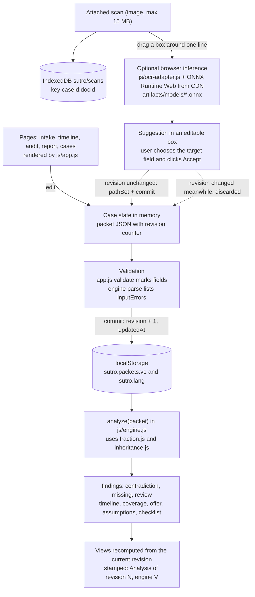

# Sutro architecture

Sutro is a pre-purchase land-evidence audit for one plot in Bangladesh (LandTech 2026, Daffodil International University). A buyer enters the documents they actually hold for a plot plus the proposed sale; the app replays those documents as an ownership timeline with exact fractions and reports what the supplied evidence supports, what it contradicts, what is missing, and what needs a person. It never decides legal title, possession or authenticity. All demo data is synthetic.

Everything in this document is derived from the code in the repository at the time of writing. Paths are relative to the repository root.

## 1. Component overview

Plain HTML, CSS and JavaScript. No build step, no bundler, no npm dependencies. Node is used only for the static server, the tests and the training helper scripts.

| Path | Role |
|---|---|
| `js/fraction.js` | `Fraction`: BigInt rational arithmetic; parses `"7/40"`, `"17.5"`, `"12"`, Bangla digits. |
| `js/inheritance.js` | `computeEstate(cert)`: narrow Hanafi intestate calculator with explicit refusals (`computed` / `unsupported` / `missing` / `invalid`). |
| `js/engine.js` | `analyze(packet)`: parse and validate, estates, chronological replay into two ledgers, findings, coverage, offer comparison, assumptions, checklist. Exports `ENGINE_VERSION` (`0.3.0`), `Ledger`, `norm`, `khatianKey`, `asciiDigits`. |
| `js/i18n.js`, `js/i18n-site.js`, `js/i18n-app.js` | English/Bangla strings. `i18n.js` holds engine strings (finding, reason, assumption and checklist keys); the other two add site chrome, home, about, case workspace, OCR and model-page strings. `digits()` renders ASCII digits as Bangla in `bn`. |
| `js/demo-packets.js` | Three hand-written synthetic packets (`demo-a`, `demo-b`, `demo-c`). |
| `js/app.js` | One page controller for every page: state in `localStorage`, header/nav/case bar, intake forms and validation, scan attachment, OCR-assist dialog, report blocks, cases table, home scene data, about-page metrics. |
| `js/idb.js` | Tiny IndexedDB wrapper for attached scans (database `sutro`, store `scans`, keys `<caseId>:<docId>`). |
| `js/ocr-adapter.js` | Loads ONNX Runtime Web from a CDN on demand and runs `artifacts/models/khatian_ocr.onnx` (line reader) and `artifacts/models/numta_cnn.onnx` (digit reader) in the browser. |
| `js/models-page.js` | Model-results page: reads `artifacts/runs/index.json` and per-run files; renders "Not measured" for anything absent. |
| `js/hero3d.js`, `js/partials.js` | Home-page three.js scene with SVG fallback; injection of header/footer containers. |
| `css/styles.css`, `css/site.css`, `css/app.css` | Document skin, site chrome, case-workspace/OCR/model-page styles. |
| `tests/*.test.js` | `node --test` suites: fraction, inheritance, engine (39 tests pass at the time of writing). |
| `scripts/serve.js` | Dependency-free static file server bound to `127.0.0.1`. |
| `scripts/kaggle.js`, `scripts/import-run.js` | Push the training dataset and kernels to Kaggle, pull outputs, import a run into `artifacts/`. |
| `notebooks/` | `01_khatian_cell_ocr_crnn.ipynb`, `02_numta_digit_cnn.ipynb`, `run_local.py`. |
| `kaggle/` | `dataset/dataset-metadata.json`, `nb01/kernel-metadata.json`, `nb02/kernel-metadata.json`. |
| `data/manifest.json`, `data/samples/` | Inventory of the datasets relied on, plus small samples (pages, crops, packets, table heads). |
| `docs/dataset-bundle-card.md` | Copy of the dataset bundle's card (`../sutro-dataset/DATASET_CARD.md`). |

The analysis engine is deterministic and uses no model. The models are input assistance only and are optional at runtime.

## 2. Runtime flow



Key points verified in `js/app.js`:

- `loadState()` merges saved packets with the demo packets by id (a saved copy of a demo wins), appends user packets, defaults `revision` to `0`, honours `?case=<id>` and saves immediately so the choice carries across pages.
- `commit(p)` is the only path that persists an accepted edit: `revision + 1`, `updatedAt`, `saveState()`, revision badge. Text edits are debounced 300 ms; structural actions (add/remove document or row, attach/remove scan, accept OCR text, rename) commit at once.
- Every service page calls `analyze(current())` on render; nothing is cached across edits. The result echoes `revision` and `engineVersion`, which the page prints.
- Attaching a scan stores `{url, blob}` in memory and `put`s the blob in IndexedDB; `hydrateScans()` reloads them on the intake page by key prefix `<caseId>:`. Deleting a document or a case deletes its keys.

## 3. Training and evaluation path

```mermaid
flowchart LR
  DS["Dataset bundle ../sutro-dataset<br/>built by its tools/ scripts<br/>synthetic khatian pages, packed cells, NumtaDB npz"]
  SPLIT["Grouped split<br/>nb01: by land_id, overlap asserted empty<br/>nb02: by image, seeded; test carved from val"]
  NB["notebooks/01_khatian_cell_ocr_crnn.ipynb<br/>notebooks/02_numta_digit_cnn.ipynb<br/>Kaggle GPU via scripts/kaggle.js or notebooks/run_local.py"]
  EVAL["Held-out evaluation, once, on the best validation checkpoint<br/>CER and exact match / accuracy, macro-F1, confusion"]
  RUN["Run folder RUN_DIR/run-id/<br/>config, dataset_manifest, split_manifest, history, metrics,<br/>model_card, ONNX, charset or preprocessing json"]
  IMPORT["scripts/import-run.js nb01 or nb02, optional activate flag"]
  IDX["artifacts/runs/index.json<br/>artifacts/runs/run-id/ (weights .pt excluded)"]
  MODELS["artifacts/models/khatian_ocr.onnx + khatian_ocr.charset.json<br/>numta_cnn.onnx + numta_cnn.preprocessing.json"]
  PAGE["models.html via js/models-page.js<br/>about.html and ocr.html metric lines"]
  ADAPTER["js/ocr-adapter.js<br/>intake OCR assist and digit pad"]
  DS --> SPLIT --> NB --> EVAL --> RUN --> IMPORT --> IDX --> PAGE
  IMPORT -->|activate flag, only status completed| MODELS --> ADAPTER
```



At the time of writing no run has been imported: `artifacts/` does not exist in the repository and the real training runs are still in progress on Kaggle. Every place that would show a metric shows its pending state instead ("Not measured", "No completed training run is included in this build", "Training run pending"). Artifacts pending.

## 4. Page map

Every page loads `fraction.js`, `inheritance.js`, `engine.js`, the three i18n files, `demo-packets.js`, `partials.js` and `app.js`; `<body data-page>` selects the behaviour. Pages with `data-casebar="true"` get the case selector, revision badge, "Blank packet", "Reset packet" (demo cases only), Export JSON and Import JSON.

| Page | `data-page` | Shows | Reads |
|---|---|---|---|
| `index.html` | `home` | Hero text, interactive three.js scene (CDN `three.min.js r128`, `js/hero3d.js`; inline SVG fallback when the viewport is narrow, reduced motion is set, WebGL is missing or the CDN script did not load), year slider, demo-case cards. | `DEMO_PACKETS` only: `analyze(demo-b)` builds the scene data; saved state is not used for the scene. |
| `cases.html` | `cases` | Table of every case: kind (demo / yours / imported / what-if), declared-synthetic flag, document count, revision, updated time, headline status with contradiction/missing/review counts; actions open, what-if copy, rename, export, delete; new case, import, export all. | All packets in `localStorage`; `analyze()` per row. Loads `idb.js` to delete a case's scans. |
| `intake.html` | `intake` (case bar) | Proposed sale, plot (mouza, JL, dag per survey), document cards with editable fields and inline validation, scan attach/preview, "Read from scan". | Current packet; scans from IndexedDB; `js/ocr-adapter.js`. |
| `timeline.html` | `timeline` (case bar) | Document strip, ordered events with chain and record accounts after each, registry-search coverage bar, side-by-side comparison of two khatians. | Current packet through `analyze()`. |
| `audit.html` | `audit` (case bar) | Headline and offer comparison, input errors, inheritance calculations with rule basis, assumptions, filterable findings in three sections. | Current packet through `analyze()`. |
| `report.html` | `report` (case bar) | Case id, generation date, revision/engine stamp, headline, "Not established by Sutro", findings, assumptions, checklist, coverage, estates, timeline; print button. | Current packet through `analyze()`. |
| `models.html` | `models` | Run selector (`?run=<id>` preselects), status tag, config and split summary, headline test metrics, training curves, per-field or per-class table, confusion matrix (raw / row-normalised), model card, download chips. | `artifacts/runs/index.json` and per-run files via `fetch`. |
| `about.html` | `about` | Problem, solution, methodology, coverage, team placeholders, limitations, AI disclosure, engine version, metric lines for active runs. | `ENGINE_VERSION`; `artifacts/runs/index.json` then each active run's `metrics.json`. |
| `ocr.html` | `ocr` | Drawing pad or upload for one handwritten Bangla digit, softmax bars (explicitly not calibrated confidence), metric line of the active digit run. | `js/ocr-adapter.js` digit model; `index.json`. Not in the main navigation; linked from About. |

Language (`sutro.lang`, `en` or `bn`) is toggled in the header and applies to every page.

## 5. Data contracts

### 5.1 Packet

A case is one JSON object. Numeric fields are stored exactly as typed (strings or numbers); Bangla digits are accepted everywhere a number is read and the raw text is kept. Khatian references are written `SURVEY-KHATIANNO`, for example `BS-512`.

```json
{
  "id": "demo-b", "synthetic": true, "revision": 3, "updatedAt": "2026-10-15T00:00:00.000Z",
  "title": {"en": "...", "bn": "..."}, "blurb": {"en": "...", "bn": "..."},
  "asOfYear": 2026,
  "plot": {"mouza": "Shantipur (synthetic)", "jl": "45", "dags": {"SA": "310", "BS": "1203"}},
  "offer": {"seller": "Rahim", "area": "50", "basisKhatian": "BS-512"},
  "docs": [
    {"id": "k-sa87", "type": "khatian", "survey": "SA", "khatianNo": "87", "year": 1962, "dag": "310", "area": "100",
     "owners": [{"name": "Karim", "share": "1"}], "provenance": "certified"},
    {"id": "h-karim", "type": "heirCert", "decedent": "Karim", "deathYear": 1985, "religion": "muslim", "school": "hanafi",
     "will": "unknown", "issuer": "Union Parishad (synthetic)",
     "heirs": [{"name": "Amena", "relation": "wife", "status": "survived", "childrenSurvived": "", "statedShare": ""}],
     "provenance": "certified"},
    {"id": "d-4417", "type": "deed", "deedNo": "4417/2011", "year": 2011, "dag": "1203",
     "sellers": [{"name": "Rahim", "area": "20"}], "buyers": [{"name": "Farid", "area": "20"}],
     "basisKhatian": "BS-512", "previousDeeds": "", "provenance": "certified"},
    {"id": "m-1", "type": "mutation", "caseNo": "M-77", "year": 2012, "deedNo": "4417/2011", "transferees": "Farid",
     "provenance": "certified"},
    {"id": "s-2005", "type": "search", "fromYear": 2005, "toYear": 2015, "dag": "1203",
     "office": "Sub-Registry Office (synthetic)", "deedsFound": "4417/2011", "provenance": "certified"}
  ]
}
```

Field notes (from `DOC`/`ROW` defaults and the intake forms in `js/app.js`, and the parser in `js/engine.js`):

- Common: `id` (unique within the packet), `type` in `khatian | deed | mutation | heirCert | search`, `provenance` in `certified | seller_copy`.
- `khatian`: `survey` in `CS | SA | RS | BS | City`, `khatianNo`, `year`, `dag`, `area` (decimals), `owners[] {name, share}` where `share` is a fraction of the whole khatian.
- `deed`: `deedNo`, `year`, `dag`, `sellers[] {name, area}`, `buyers[] {name, area}` (areas in decimals), `basisKhatian`, `previousDeeds` (comma/semicolon/newline-separated string or array).
- `mutation`: `caseNo`, `year`, `deedNo`, `transferees` (list string).
- `heirCert`: `decedent`, `deathYear`, `religion` in `muslim | hindu | christian | buddhist | other | unknown`, `school` in `hanafi | other | unknown`, `will` in `no | yes | unknown`, `issuer`, `heirs[] {name, relation (wife | husband | son | daughter | father | mother | other), status (survived | predeceased), childrenSurvived ('' | unknown | no | yes), statedShare}`.
- `search`: `fromYear`, `toYear`, `dag`, `office`, `deedsFound` (list string).
- Packet-level optional fields: `provenance` (`user` or `imported`), `parentId` (what-if copies), `labels` (kept from imported files, never read by the engine), `ocrRaw` (map of field path to the text accepted from the line reader).

### 5.2 Analysis result

`analyze(packet)` returns `{ engineVersion, revision, asOfYear, synthetic, findings, inputErrors, timeline, estates, coverage, offer, assumptions, checklist, summary, rootDocId }`. A finding is `{ kind, code, params, docs }` with `kind` in `contradiction | missing | review` and `docs` the ids it cites. Shares in `timeline`, `estates` and `offer` are `Fraction` instances, never floats. `coverage` is `{ from, to, covered: [[from, to, docId]], gaps: [[from, to]] }`. `offer` is `null` until a seller and a positive area are entered and a root khatian exists.

### 5.3 Run-artifact folder

Each notebook writes one folder named by its run id (`khatian-crnn-YYYYMMDD-HHMMSS` or `numta-cnn-YYYYMMDD-HHMMSS`):

| File | Written by | Content |
|---|---|---|
| `config.json` | both | run id, task, model description, epochs, batch, lr, optimizer, augmentation, seed, device, framework (`smoke` flag in nb01) |
| `dataset_manifest.json` | both | data source, file name, sha256, counts per split, grouping statement, per-field or per-class counts |
| `split_manifest.json` | both | nb01: page ids and land ids per split; nb02: the seeded index lists that carve val and test out of the npz validation slice |
| `history.json` | both | per-epoch loss and validation metrics |
| `metrics.json` | both | `status`, `test` block (nb01: `cer`, `exact`, `n`, `by_field`; nb02: `accuracy`, `macro_f1`, `per_class`), validation figures, `n_train/n_val/n_test`, inference timing, `smoke`, a scope note |
| `confusion_matrix.json` | nb02 | `labels`, `labels_bn`, `matrix` (rows true, columns predicted) |
| `charset.json` | nb01 | `chars`, `height`, `downsample`, `blank`, normalisation and input/output description |
| `preprocessing.json` | nb02 | input/output description, `classes`, ONNX parity |
| `model_card.md` | both | task, data, model, results, export, limitations |
| `khatian_ocr.onnx` / `numta_cnn.onnx` | nb01 / nb02 | exported model, opset 17 |
| `best.pt`, `samples.png` | both / nb01 | checkpoint and sample plot; `.pt` is not copied by the import script |

### 5.4 `artifacts/runs/index.json`

Written only by `scripts/import-run.js`:

```json
{
  "runs": [
    {"id": "khatian-crnn-20261015-120000", "dir": "artifacts/runs/khatian-crnn-20261015-120000", "kind": "line-ocr",
     "task": "...", "status": "completed", "active": true, "timestamp": "20261015-120000", "device": "cuda", "epochs": 30}
  ],
  "generated": "2026-10-15T12:34:56.000Z"
}
```

`kind` is `line-ocr` (nb01) or `digit` (nb02). `status` is `smoke` when `metrics.json` has `smoke: true`, otherwise `metrics.status`, or `failed` when `metrics.json` is absent. Runs are sorted by timestamp, newest first. `--activate` sets `active` for at most one run per kind and copies its ONNX and metadata file into `artifacts/models/`. The models page additionally derives the displayed status from `metrics.json` itself and falls back to `failed`.

## 6. Storage and privacy behaviour

| Data | Where | Survives reload | Leaves the browser |
|---|---|---|---|
| Cases (packets, current case id) | `localStorage["sutro.packets.v1"]` | Yes, until site data is cleared | Only when the user clicks Export JSON (a file download) |
| Language | `localStorage["sutro.lang"]` | Yes | No |
| Attached scans | IndexedDB `sutro` / `scans`, key `<caseId>:<docId>` | Yes if IndexedDB is available; otherwise previews are session-only | No; scans are not part of the JSON export |
| OCR suggestion | Dialog state only | No | No; inference runs in the page |
| Comparison picks, finding filters | Memory | No | No |

- The static server (`scripts/serve.js`) serves files only; there is no API, no form submission endpoint and no request logging beyond the console banner.
- Network calls made by the pages: `three.min.js` from cdnjs on the home page; ONNX Runtime Web (`onnxruntime-web@1.20.1`) from jsDelivr only when a reader is initialised (opening the OCR dialog on intake, or loading `ocr.html`) and its metadata file exists; same-origin `fetch` of `artifacts/runs/...` and `artifacts/models/...`. No case data is included in any of these requests.
- If `localStorage.setItem` throws (quota, private mode), the app shows "Could not save to browser storage" once and keeps the edit in memory only.
- Imports are capped at 5 MB and scans at 15 MB; an import keeps the file's `synthetic` flag only when it is literally `true` and tags the case `provenance: "imported"`.
- Nothing is synchronised between devices or browsers. Clearing site data erases every case and scan.

## 7. What is deliberately not built

- No backend, database or API: the whole audit runs in the page; the only server is a static file server.
- No accounts or authentication: a case belongs to the browser profile it was created in.
- No live government integration: e-Khatian, e-Mutation, sub-registry records, the forged-document register and court-case feeds are not connected; every value is typed in (the home page lists these as "Not available in this prototype").
- No cloud storage, backup or cross-device sync.
- No AI model inside the evidence engine; the two models only suggest text, and nothing enters a case without the user clicking Accept.
- No determination of legal title, possession or document authenticity, and no detection of forged paper.
- No succession rules beyond the narrow Hanafi case in `js/inheritance.js`; everything else is refused and routed to review.
- **Undo / per-field revision history.** Only a revision counter and *what-if copies* exist; there is no step-by-step undo. Export a copy before risky edits.
